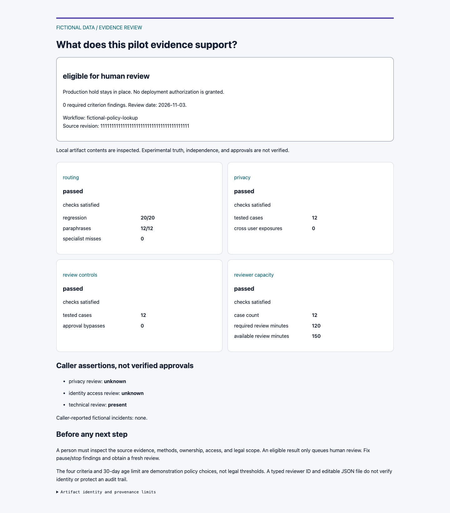
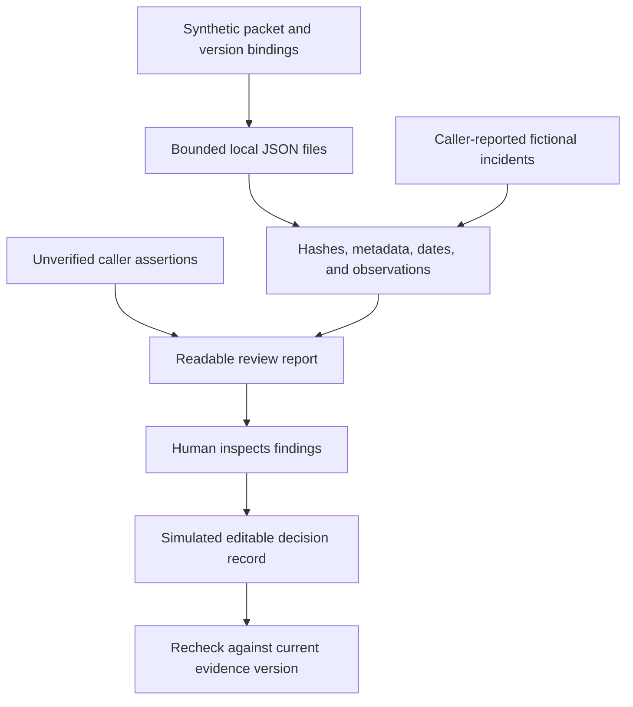

# HR AI pilot evidence review

HR leaders need to see which pilot findings support a next step and which gaps require a pause.
This offline tool checks version-bound fictional evidence files and produces a review report for HR, People Operations, and AI enablement leads.
It keeps missing evidence and recorded failures visible before a person considers expansion.

[Review examples](#what-the-examples-show) · [Contract](CONTRACT.md) · [Tests](../../tests/pilot_review/test_review.py) · [CI](../../.github/workflows/pilot-review.yml)

## Five-minute quickstart

Requires Python 3.11 or later. No packages, model access, or API keys are needed.
From the repository root:

```bash
python3 09-evals/pilot-review/review.py review 09-evals/pilot-review/examples/ready/packet.json --as-of 2026-11-03
python3 -m unittest discover -s tests/pilot_review -v
```

The first command returns `eligible_for_human_review`, keeps the production hold, and grants no authorization. The example numbers are authored fictional inputs, not results from a live pilot or model evaluation. The fixed date makes the examples reproducible; omitting `--as-of` uses the current UTC date and can make old examples stale.

To produce a local HTML report:

```bash
python3 09-evals/pilot-review/review.py review 09-evals/pilot-review/examples/ready/packet.json --as-of 2026-11-03 --format html > pilot-review.html
```

Open `pilot-review.html` in a browser. The report is self-contained, uses no scripts or remote fonts, and makes no network calls. The shell writes the redirected file; the tool itself reads evidence and writes standard output only. Use a new output filename to preserve an earlier review.



[Mobile report capture](assets/review-mobile.png) · [Preserved Resolve failure report](assets/resolve-review-desktop.png)

## What the examples show

| Packet under `examples/` | Expected disposition | Why |
|---|---|---|
| `ready/packet.json` | `eligible_for_human_review` | All four artifact checks pass under the demonstration policy. Caller approval assertions remain unverified. |
| `pause/packet.json` | `pause` | Review-control evidence is missing and fictional review capacity is insufficient. |
| `stop/packet.json` | `stop` | The fictional privacy test record reports an exposure. |
| `reported-incident/packet.json` | `stop` | A caller reports a fictional approval bypass, even though artifacts are absent. |
| `resolve/packet.json` | `pause` | The preserved rules report contains 60/60 regression successes, 0/16 paraphrase successes, and five specialist-routing misses. The observation is also old under the demonstration age limit. |

The Resolve example wraps a public synthetic report from [source revision 074246e](https://github.com/ellehelvig/peopleops-resolution-agent/blob/074246e4e026e310e16616b11b44f3fe73cd5a59/evals/latest_report.json). Its original report data and observation date are preserved. It is not a new model run or independent evaluation. The adapter reconciles summaries with case results before using the counts. See [snapshot provenance](examples/resolve/PROVENANCE.md).

For example, this command deliberately exits `1` and prints the pause report:

```bash
python3 09-evals/pilot-review/review.py review 09-evals/pilot-review/examples/resolve/packet.json --as-of 2026-11-03
```

## What is checked

- Exact local artifact bytes against declared SHA-256 values.
- Matching workflow, source revision, dataset, method, criterion, and observation date between the packet and artifact.
- Required artifacts, dates, typed measurements, denominators, and contradictory counts.
- Routing results, recorded privacy exposures, recorded approval bypasses, and review capacity.
- A review record's match to the same evidence bytes, policy, and review date.

`synthetic-pilot-review-v1` requires routing, privacy, review-controls, and reviewer-capacity evidence. Any failed or absent required criterion pauses review. A recorded exposure, bypass, or caller-reported incident takes stop priority. The 30-day age limit and all-checks-pass thresholds are demonstration policy choices, not legal requirements or validated operating thresholds. They cannot be lowered inside a packet.

Hashes identify content. Matching metadata does not prove that the declared code revision produced those results, that an experiment happened, or that its author is independent. Caller assertions are displayed separately and cannot clear evidence blockers. The full [contract](CONTRACT.md) describes accepted fields and failure behavior.

## Human review record

Use a fictional reviewer ID. This example writes an editable proposed decision record:

```bash
python3 09-evals/pilot-review/review.py record 09-evals/pilot-review/examples/ready/packet.json --as-of 2026-11-03 --reviewer reviewer-01 --disposition eligible_for_human_review > pilot-review-record.json
python3 09-evals/pilot-review/review.py verify-record 09-evals/pilot-review/examples/ready/packet.json pilot-review-record.json --as-of 2026-11-03
```

A record can choose a more conservative disposition but cannot clear a stop or mark a blocked packet eligible. Changing evidence, metadata, policy, or review date invalidates the match. Typed IDs are not authentication. Local JSON is editable and unsigned; anyone with write access can replace both evidence and records. Verification establishes consistency only, never reviewer identity or protected audit evidence.

## Architecture



This extends the playbook's [adoption plan](../../04-enablement/adoption-playbook.md) and [roadmap](../../06-roadmap/README.md). It complements the assertion-based preflight in [PR #52](https://github.com/ellehelvig/hr-ai-transformation-playbook/pull/52) and advisory prompt in [PR #51](https://github.com/ellehelvig/hr-ai-transformation-playbook/pull/51). It does not import or change either proposal. Those PRs remain separately reviewable.

## Limitations and responsible use

- Use fictional inputs only. The synthetic label and identifier syntax are caller assertions, not a PII detector. Never load real employee, candidate, health, pay, or confidential employer data.
- This is a local evidence rehearsal, not a deployment gate, authenticated approval system, protected audit trail, independent fairness assessment, or legal determination.
- The tool inspects recorded files; it does not rerun the declared system, verify external source control, establish dataset independence, or detect a coordinated replacement of artifacts and hashes.
- Local filesystem races, file permissions, terminal logs, and the surrounding operating system remain outside this prototype's controls. Do not run it against an attacker-controlled, concurrently changing directory.
- Candidate scoring, employment decisions, real HR-system writes, provider calls, and employee-facing operation are out of scope. The tool performs no HR action.

Governance references reviewed 3 November 2026:

| Primary source | Design connection and boundary |
|---|---|
| [NIST AI RMF](https://www.nist.gov/itl/ai-risk-management-framework) | Its voluntary risk-management approach informs explicit criteria, source context, measurement review, and accountable next steps. This tool is not NIST certification. |
| [European Commission AI Act overview](https://digital-strategy.ec.europa.eu/en/policies/regulatory-framework-ai) | Employment use cases can fall within high-risk categories, with oversight and recordkeeping considerations. Version-bound evidence can support a review conversation; this prototype does not establish legal classification or satisfy applicable obligations. |
| [NYC DCWP AEDT guidance](https://www.nyc.gov/site/dca/about/automated-employment-decision-tools.page) | Covered AEDT uses require a bias audit, public audit information, and notices. These synthetic routing checks are not that audit and do not assess whether a particular use is covered. |

HR, Legal, Privacy, and Security owners must determine applicable duties before considering any real use. Use the playbook's [governance references](../../03-governance/README.md) for that discussion. No new legal deadline or compliance outcome is claimed here.

## Roadmap

After practitioner review, consider independently produced evidence adapters and a clearer policy-extension contract. Authenticated identity, signed evidence, access controls, durable records, and any real deployment integration would require a separate threat model, approval, and implementation. They are not demonstrated here.

The current scope is deliberately limited to offline synthetic evidence review. [MIT license](../../LICENSE) · [Contributing](../../CONTRIBUTING.md)
