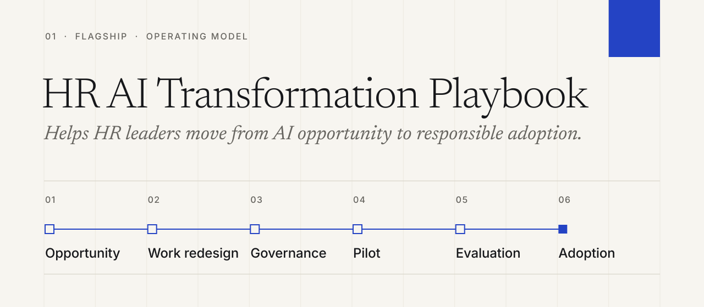

<picture>
  <source media="(max-width: 600px) and (prefers-color-scheme: dark)" srcset="assets/playbook-mobile-dark.svg">
  <source media="(max-width: 600px)" srcset="assets/playbook-mobile-light.svg">
  <source media="(prefers-color-scheme: dark)" srcset="assets/playbook-dark.svg">
  
</picture>

  <a href="#the-point-of-view">Overview</a> &nbsp;·&nbsp;
  <a href="#the-journey">Explore the work</a> &nbsp;·&nbsp;
  <a href="#evidence-and-limits">Evidence</a>

  
  
  

 

## At a glance

| Aspect | Summary |
|:--|:--|
| **Purpose** | An operating model for responsible HR AI adoption. |
| **Explore** | [Opportunity, work redesign, governance, pilot, evaluation, adoption](#the-journey). |
| **Evidence** | [Technical evidence and setup](docs/evidence-index.md). |
| **Scope** | Reference materials and synthetic demonstrations; [evidence and limits](#evidence-and-limits). |

 

## The point of view

Most HR AI programs stall in one of three places: they start with the wrong use case, they cannot get through Legal and Privacy, or nobody changes how they work. This playbook takes a position on each.

1. **Start with the decision, not the tool.** Score every idea on value, risk, and readiness before anyone buys anything.
2. **Governance is a design input, not a gate at the end.** Legal, Privacy, and employee representatives see the intake before the build starts.
3. **Humans make consequential employment decisions.** AI can inform hiring, pay, and performance decisions. It never makes them. The tools here return evidence flagged for human review, never a decision, and [Resolve](https://github.com/ellehelvig/peopleops-resolution-agent) holds its recommendations for a person to approve or reject.
4. **Measure changed work, not launched tools.** A tool nobody trusts is a cost. Training and measurement are planned from day one.

 

## The journey

Each stage answers one question before the next begins. Work moves forward when the evidence supports it, not when the calendar says so.

<picture>
  <source media="(max-width: 600px) and (prefers-color-scheme: dark)" srcset="assets/journey-mobile-dark.svg">
  <source media="(max-width: 600px)" srcset="assets/journey-mobile-light.svg">
  <source media="(prefers-color-scheme: dark)" srcset="assets/journey-dark.svg">
  
</picture>

- **Opportunity.** Start with the [prioritization matrix](01-use-cases/prioritization-matrix.md), then the [use case library](01-use-cases/README.md) and [intake template](01-use-cases/intake-template.md).
- **Work redesign.** Start with [the People Partner role](01-use-cases/work-redesign-people-partner.md), then the [workflow patterns](07-agentic-patterns/README.md).
- **Governance.** Start with the [AI use policy](03-governance/ai-use-policy.md), then the [governance references and key dates](03-governance/README.md).
- **Pilot.** Start with the [transformation roadmap](06-roadmap/transformation-roadmap-template.md), then the [phase gates and KPIs](06-roadmap/README.md).
- **Evaluation.** Start with the [eval framework](09-evals/README.md), then [ROI measurement](08-roi-measurement/README.md).
- **Adoption.** Start with the [adoption playbook](04-enablement/adoption-playbook.md), then the [literacy curriculum](04-enablement/hr-ai-literacy-curriculum.md).

 

## Where to start

- **5 minutes. [Work redesign: the People Partner role](01-use-cases/work-redesign-people-partner.md).** One HR role broken into tasks: where rules, AI, and people each belong, what evidence supports each choice, and why no task yet earns end-to-end model autonomy.
- **2 minutes. [Prioritization matrix](01-use-cases/prioritization-matrix.md).** How to pick the first three use cases, with a worked example.
- **2 minutes. [Resume screening tool](10-mcp-agents/resume_screen/ENABLEMENT.md).** A deterministic tool an AI assistant can call. It shows the evidence for each job requirement, returns no fitness score, never compares candidates, and lists what its design cannot prevent.

**New here?** HR leaders start with the [use cases](01-use-cases/README.md). Legal and Privacy partners start with the [AI use policy](03-governance/ai-use-policy.md). Engineers start with the [MCP tools](10-mcp-agents/README.md).

<strong>Every section in the repository</strong>

| Stage | The question it answers | Sections |
|:--|:--|:--|
| **Decide** | What should we build first, and in what order? | [01 · Use cases](01-use-cases/README.md): HR AI use-case examples, a prioritization matrix, and a [work redesign case study](01-use-cases/work-redesign-people-partner.md) [06 · Roadmap](06-roadmap/README.md): an 18-month plan with phase gates |
| **Govern** | Can we deploy this responsibly? | [03 · Governance](03-governance/README.md): AI use policy, risk assessment, EU AI Act intake, vendor review, incident response, and [key legal dates](03-governance/README.md#key-dates-for-hr) |
| **Build** | How do we make it work, safely? | [02 · Prompts](02-prompt-library/README.md) for eight HR functions [11 · Skills](11-skills/README.md): installable agent skills [07 · Workflow patterns](07-agentic-patterns/README.md) [10 · MCP tools](10-mcp-agents/README.md), [09 · Evals](09-evals/README.md), [05 · Notebooks](05-notebooks/README.md) |
| **Adopt and prove** | Will people use it, and is it worth it? | [04 · Enablement](04-enablement/README.md): a literacy curriculum and a 90-day adoption plan [08 · ROI](08-roi-measurement/README.md): business case, metrics, and reporting |

 

## What this demonstrates

Built by Elle Helvig, an HR transformation leader. I defined the HR problems, designed the operating model and governance approach, and built the tools with AI-assisted development. The work shows four things a People AI program needs from one leader:

- **Strategy.** Turning a long list of AI ideas into a sequenced, fundable roadmap.
- **Governance.** Translating the EU AI Act, GDPR, and US state and city laws into templates HR teams can actually fill in.
- **Hands-on building.** Working tools, agent skills, and evaluations, not slideware.
- **Adoption.** Training, change management, and the metrics that show whether it worked.

 

## Evidence and limits

**Scope.** Reference materials and synthetic demonstrations. The People Partner redesign is a proposal informed by prototype failures, with no measured business outcome or completed employee pilot. A review flag in a tool's output is not an enforced approval system. All data is synthetic.

**Jurisdictions.** Covers the EU, the US (federal, New York City, and several states), the UK, and Ontario. Not APAC, Latin America, the Middle East, or Africa. Legal dates are reviewed by hand each quarter in the [Key dates for HR](03-governance/README.md#key-dates-for-hr) table. None of this is legal advice; have Legal and Privacy review any document before you adopt it.

**For technical reviewers.** The [technical evidence and setup](docs/evidence-index.md) page lists what the code, tests, and evaluations show, and what they do not. Every count it states is recomputed from the repository in CI. Nothing assumes a specific HRIS, ATS, or model provider.

 

---

MIT licensed. [Contributing](CONTRIBUTING.md) · [Changelog](CHANGELOG.md) · [Cite this work](CITATION.cff) · [Elle Helvig](https://github.com/ellehelvig) · [LinkedIn](https://www.linkedin.com/in/ellehelvig/)
