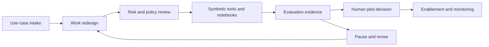

# HR AI Transformation Playbook

A reference toolkit for HR leaders choosing where AI belongs in people work.
Use it to select a use case, redesign tasks, plan governance and enablement, and evaluate a synthetic prototype.

[Evidence and limits](docs/evidence-index.md) · [Read online](https://ellehelvig.github.io/hr-ai-transformation-playbook/) · [Tests](https://github.com/ellehelvig/hr-ai-transformation-playbook/actions/workflows/ci.yml) · [Resolve demo](https://ellehelvig.github.io/peopleops-resolution-agent/)

**Reference materials and synthetic demonstrations.** No completed employee pilot or measured business outcome is claimed. A review flag in a tool response is not an enforced approval system.

## Start with one decision

- **Choose a use case:** [prioritization matrix](01-use-cases/prioritization-matrix.md) and [intake template](01-use-cases/intake-template.md).
- **Redesign the work:** [fictional People Partner example](01-use-cases/work-redesign-people-partner.md), with tasks split between rules, AI assistance, and people.
- **Plan adoption:** [literacy curriculum](04-enablement/hr-ai-literacy-curriculum.md), [facilitator guide](04-enablement/workshop-facilitator-guide.md), and [adoption plan](04-enablement/adoption-playbook.md).
- **Inspect the software:** [MCP tools](10-mcp-agents/README.md), [notebooks](05-notebooks/README.md), and [evaluation framework](09-evals/README.md).

## Run a synthetic example

Requires Python 3.11 or later. From a directory where you want the clone:

```bash
git clone https://github.com/ellehelvig/hr-ai-transformation-playbook.git
cd hr-ai-transformation-playbook
python3 -m venv .venv
source .venv/bin/activate
python -m pip install --require-hashes --no-deps -r requirements-bootstrap.txt
python -m pip install -r requirements-lock.txt
python -m pip check
```

From that same root and environment:

```bash
python - <<'PY'
import sys
sys.path.insert(0, "10-mcp-agents")
from comp_banding.tool import get_band_position
result = get_band_position("Recruiter", "IC3", "tier1", 105000, False)
print(result["human_review_required"])
PY
python -m pytest 10-mcp-agents 09-evals -q
python scripts/verify_claims.py
```

Expected example output: `True`. The input uses fictional benchmark data. It does not approve pay or establish compensation fairness. Read the [tool's handoff and limitations](10-mcp-agents/comp_banding/ENABLEMENT.md) before adapting it. Full setup, Windows activation, and dependency maintenance are in [reproducible setup](docs/reproducible-setup.md).

## How the pieces connect



This is the proposed operating model. The diagram does not represent an automated approval or deployment system.

## Explore the reference materials

[Use cases](01-use-cases/README.md) · [Draft prompts](02-prompt-library/README.md) · [Governance](03-governance/README.md) · [Enablement](04-enablement/README.md) · [Notebooks](05-notebooks/README.md) · [Roadmap](06-roadmap/README.md) · [Workflow patterns](07-agentic-patterns/README.md) · [ROI measurement](08-roi-measurement/README.md) · [Evals](09-evals/README.md) · [MCP tools](10-mcp-agents/README.md) · [Agent skills](11-skills/README.md)

## Evidence and responsible use

The [evidence index](docs/evidence-index.md) distinguishes executed code from reference responses, proposed controls, and unvalidated model behavior. No prompt result or model-judge reliability is claimed without a recorded run. [Resolve](https://github.com/ellehelvig/peopleops-resolution-agent) is a separate workflow prototype with published failures and a production hold.

Human owners retain consequential employment decisions. Templates need adaptation and review by HR, Legal, Privacy, and Security as relevant. Legal scope and dates vary by jurisdiction; see the [governance sources and review dates](03-governance/README.md). This is not legal advice.

Elle Helvig defined the HR problems, operating model, and governance approach, and built the tools with AI-assisted development.

[MIT license](LICENSE) · [Contributing](CONTRIBUTING.md) · [Changelog](CHANGELOG.md) · [Cite this work](CITATION.cff) · [Elle Helvig](https://github.com/ellehelvig)
